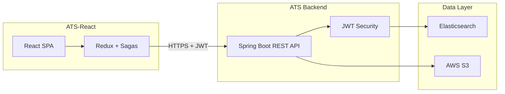

# Application Tracking System (ATS)

A full-stack recruiter platform for uploading candidate resumes, searching applicant profiles with full-text search, and managing the hiring pipeline.

**Frontend:** [ATS-React](https://github.com/tanveer3567/ATS-React) · **Backend:** this repo

## Problem

Recruiters need a centralized system to store candidate profiles, upload resumes, and quickly search across education, experience, and skills. This ATS provides JWT-secured CRUD operations, Elasticsearch-powered search, and S3-backed resume storage.

## Architecture



## Tech Stack

| Layer | Technologies |
|-------|-------------|
| Backend | Java 8, Spring Boot 2.3, Spring Security, Spring Data Elasticsearch |
| Auth | JWT (jjwt), BCrypt password hashing |
| Search | Elasticsearch multi-match queries across applicant fields |
| Storage | AWS S3 for resume PDF/DOC uploads |
| API docs | Springfox Swagger 2.8 |
| Frontend | React 16, Redux, Redux Saga, Material-UI ([ATS-React](https://github.com/tanveer3567/ATS-React)) |

## Features

- **User registration & login** — JWT-based authentication
- **7-step applicant wizard** — resume upload, personal details, education, experience, screening questions, profiles, equal employment
- **Full-text search** — Elasticsearch multi-match across all applicant fields
- **Resume management** — upload to S3, download by key
- **CRUD operations** — create, view, update, delete applicants from search results

## API Endpoints

| Method | Endpoint | Description |
|--------|----------|-------------|
| `POST` | `/user/register` | Register recruiter account |
| `POST` | `/user/authenticate` | Login, returns JWT |
| `POST` | `/applicant/add` | Create applicant profile |
| `POST` | `/applicant/search` | Full-text search |
| `PUT` | `/applicant/update/{id}` | Update applicant |
| `DELETE` | `/applicant/delete/{id}` | Delete applicant |
| `POST` | `/applicant/upload` | Upload resume to S3 |
| `GET` | `/applicant/download/{key}` | Download resume from S3 |

## Getting Started

### Prerequisites

- Java 8+, Maven
- Elasticsearch instance (local or AWS OpenSearch)
- AWS S3 bucket with credentials
- [ATS-React](https://github.com/tanveer3567/ATS-React) frontend (optional, for full UI)

### Configuration

Create `src/main/resources/application.properties` (not committed — contains secrets):

```properties
# JWT
jwt.secret=<your-jwt-secret>

# AWS S3
amazonProperties.endpointUrl=https://s3.amazonaws.com
amazonProperties.bucketName=<your-bucket>
amazonProperties.accessKey=<your-access-key>
amazonProperties.secretKey=<your-secret-key>

# Elasticsearch
amazonProperties.esEndpoint=<your-es-host>
amazonProperties.esPort=443
```

### Run backend

```bash
git clone https://github.com/tanveer3567/ATS.git
cd ATS
mvn clean install
mvn spring-boot:run
```

API runs on **http://localhost:8080**. Swagger UI available at `/swagger-ui.html`.

### Run frontend

```bash
git clone https://github.com/tanveer3567/ATS-React.git
cd ATS-React
npm install
npm start
```

Frontend runs on **http://localhost:3000**. Update `src/endpoints.js` to point to your backend URL.

## User Flows

1. **Register** → create recruiter account stored in Elasticsearch `user` index
2. **Login** → receive JWT, redirect to applicant dashboard
3. **Add applicant** → 7-step wizard ending with `POST /applicant/add`
4. **Search** → sidebar search triggers `POST /applicant/search`, results in table
5. **Update / Delete** → actions from search results table

## Project Structure

```
ATS/
├── src/main/java/com/rsit/ats/
│   ├── config/          # JWT filter, Swagger, security
│   ├── controller/      # UserController, ApplicantController
│   ├── service/         # UserService, ApplicantService
│   ├── client/          # AmazonClient (S3), ElasticHttpClient
│   └── model/           # User, Applicant entities
└── pom.xml
```

## What I Learned

- Integrating Elasticsearch as the primary data store for flexible document search
- JWT-secured REST APIs with Spring Security filter chains
- S3 file upload/download patterns for resume management
- Full-stack coordination between React multi-step forms and Spring Boot APIs

## Future Work

- [ ] Migrate Elasticsearch to PostgreSQL full-text search for simpler local dev
- [ ] Docker Compose for local Elasticsearch + backend
- [ ] Upgrade to Spring Boot 3 and Java 17
- [ ] Add role-based access (recruiter vs admin)

## Related

- **Frontend:** [github.com/tanveer3567/ATS-React](https://github.com/tanveer3567/ATS-React)
- **Serverless variant:** [github.com/tanveer3567/rsrit-ats](https://github.com/tanveer3567/rsrit-ats) (AWS SAM starter)
